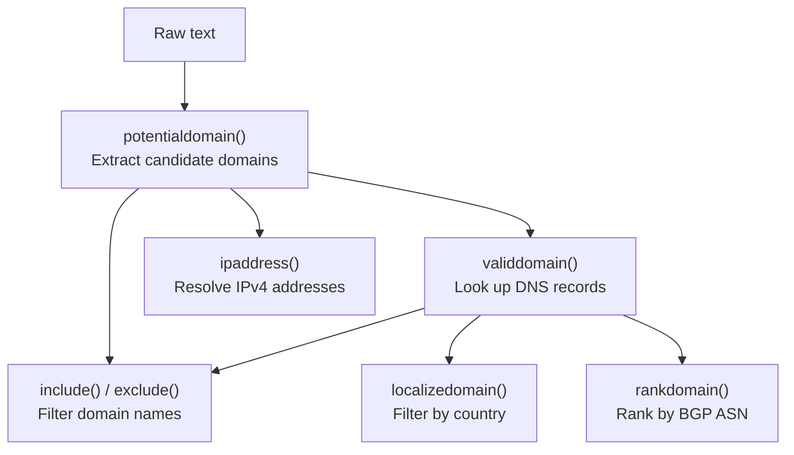

# DomainClassifier

DomainClassifier extracts hostnames from unstructured text. It can validate them
against DNS, resolve IPv4 addresses, filter by country or regular expression,
and rank domains using BGP data. It can also emit passive DNS records.



## Installation

Use Python 3.7 or later. Install the dependencies in a virtual environment and
run the examples from the checkout root.

```sh
python -m pip install 'dnspython>=2.0' IPy redis
```

The latest PyPI release depends on `pybgpranking`, which is currently unavailable
from PyPI. The source checkout works with the dependencies above for extraction
and DNS. [DomainClassifier on PyPI](https://pypi.org/project/DomainClassifier/)

Install the client from the pinned upstream revision to use BGP ranking.

```sh
python -m pip install 'pybgpranking @ git+https://github.com/D4-project/BGP-Ranking.git@aa7741710eadc608aeb1ae8bfac31a86c8207dd8#subdirectory=client'
```

## Quick start

```python
from DomainClassifier.domainclassifier import Extract

classifier = Extract(rawtext="Visit example.com or email admin@example.org.")
print(classifier.potentialdomain())  # ['example.com', 'example.org']
print(classifier.include(r"\.org$"))  # {'example.org'}
```

On first use, `Extract` fetches the IANA root zone TLD list and caches it at
`~/.DomainClassifier/tlds`. By default, candidate domains must have a TLD from
that list. Call `potentialdomain(validTLD=False)` to retrieve the unfiltered
matches from the same text. [IANA TLD list](https://data.iana.org/TLD/tlds-alpha-by-domain.txt)

### DNS and classification

```python
records = classifier.validdomain(rtype=["A", "AAAA"], extended=True)
for hostname, record_type, answer in records:
    print(hostname, record_type, answer)
```

- `Extract` accepts a `nameservers` list and a DNS `port`. The default resolver
  is `8.8.8.8` on port 53.
- After a lookup with `extended=True`, call `localizedomain(cc="US")` to filter
  results by country or `rankdomain()` to rank them using the BGP client.
  These lookups use external services.
- Use `validdomain(extended=False, passive_dns=True)` for passive DNS output or
  `ipaddress()` for IPv4 addresses.
- `include()` and `exclude()` match against the DNS results when available and
  against the candidate domains otherwise.
- To enable optional Redis caching, pass `redis_host` to `Extract`.

## Software using DomainClassifier

- [AIL framework - Analysis Information Leak framework](https://github.com/ail-project/ail-framework)

## License

~~~~
Copyright (C) 2012-2023 Alexandre Dulaunoy - a(at)foo.be
Copyright (C) 2021 Aurelien Thirion

This program is free software: you can redistribute it and/or modify
it under the terms of the GNU Affero General Public License as
published by the Free Software Foundation, either version 3 of the
License, or (at your option) any later version.

This program is distributed in the hope that it will be useful,
but WITHOUT ANY WARRANTY; without even the implied warranty of
MERCHANTABILITY or FITNESS FOR A PARTICULAR PURPOSE.  See the
GNU Affero General Public License for more details.

You should have received a copy of the GNU Affero General Public License
along with this program.  If not, see <http://www.gnu.org/licenses/>.
~~~~
